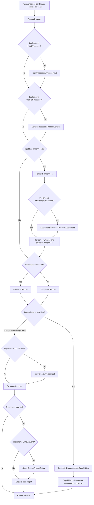
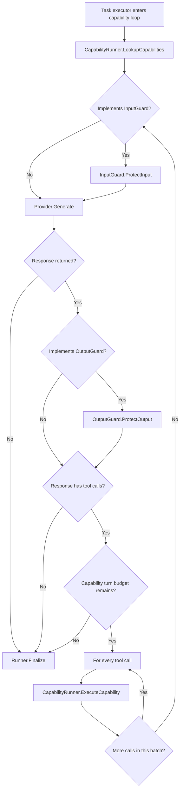

# Horizon

[](https://github.com/rotationalio/horizon/actions/workflows/tests.yaml)
[](https://pkg.go.dev/go.rtnl.ai/horizon)

Horizon decouples AI providers from AI execution and provides a single inference API.

**License:** [BSD 3-Clause](LICENSE)

## Install

```sh
go get go.rtnl.ai/horizon
```

The examples below use the root `horizon` package, which has helpful aliases for important types and functions.

## Quickstart

This example assumes a local OpenAI-compatible server is listening at `localhost:8000` and serves the Chat Completions API with the `llama3.2` model. It defines a task, runs it once, and prints the result:

```go
package main

import (
    "context"
    "fmt"
    "log"
    "time"

    "go.rtnl.ai/horizon"
    "go.rtnl.ai/ulid"
)

type runner struct{}

func (runner) Prepare(context.Context, *horizon.Task) error { return nil }
func (runner) Finalize(context.Context, *horizon.TaskOutput, error) error { return nil }

func main() {
    providerConfig := horizon.ProviderConfig{
        ID:                ulid.Make(),
        ProviderType:      horizon.ProviderTypeOpenAICompatible,
        APIType:           horizon.ProviderAPITypeOpenAIChatCompletions,
        InferenceEndpoint: "http://localhost:8000/v1",
        CatalogEndpoint:   "http://localhost:8000/v1/models",
        DefaultModel:      "llama3.2",
        Credentials:       horizon.NewNoneCredentials(),
    }
    tsk := &horizon.Task{
        Name:     "Greeting",
        Slug:     "greeting",
        Provider: &providerConfig,
        Model:    horizon.TaskModel{Slug: providerConfig.DefaultModel},
        Prompts: horizon.PromptTemplates{{
            Index: 0, Role: horizon.PromptRoleUser, Renderer: horizon.RendererGo,
            Content: "Say hello to {{.name}}.",
        }},
        Output: &horizon.TaskOutputSchema{Modality: horizon.ModalityText},
    }

    ctx, cancel := context.WithTimeout(context.Background(), 30*time.Second)
    defer cancel()
    output, err := horizon.Run(ctx, &horizon.TaskInput{
        Context: horizon.PromptContext{"name": "Ada"},
    }, tsk, runner{})
    if err != nil {
        log.Fatal(err)
    }
    fmt.Println(output.Output)
}
```

The root package aliases common API types with explicit names such as `TaskInput`, `PromptContext`, `ProviderConfig`, and `ProviderCredentials`. It also exposes credential constructors such as `horizon.NewNoneCredentials`, `horizon.NewAPIKeyCredentials`, etc.

## Configuration

Horizon reads these settings from `HORIZON_*` environment variables when configuration is first loaded. Defaults apply when a setting is omitted. See [`config/config.go`](config/config.go) for the fields, defaults, and validation rules. Durations use Go duration syntax (for example, `500ms` or `2m`); attachment size limits are in bytes. You can also override settings programmatically with `config.Set`.

| Setting                      | Environment variable                    | Default             | How to interpret it                                                                                                |
| ---------------------------- | --------------------------------------- | ------------------- | ------------------------------------------------------------------------------------------------------------------ |
| `RendererCacheSize`          | `HORIZON_RENDERER_CACHE_SIZE`           | `128`               | Maximum number of compiled template renderers to cache. Must be positive.                                          |
| `ProviderCacheSize`          | `HORIZON_PROVIDER_CACHE_SIZE`           | `32`                | Maximum number of provider instances to cache. Must be positive.                                                   |
| `MaxToolTurns`               | `HORIZON_MAX_TOOL_TURNS`                | `32`                | Maximum model/tool turns per task. `0` disables tool calling; a task-level `params.MaxToolTurns` can override it.  |
| `AttachmentMaxDownloadBytes` | `HORIZON_ATTACHMENT_MAX_DOWNLOAD_BYTES` | `67108864` (64 MiB) | Maximum size of each remotely downloaded attachment. Must be positive.                                             |
| `AttachmentDownloadTimeout`  | `HORIZON_ATTACHMENT_DOWNLOAD_TIMEOUT`   | `8s`                | Maximum time to download a remote attachment. Must be positive.                                                    |
| `ExecutionTimeout`           | `HORIZON_EXECUTION_TIMEOUT`             | `0s`                | Maximum time for one whole execution. `0` means the caller's context controls the timeout.                         |
| `FinalizeTimeout`            | `HORIZON_FINALIZE_TIMEOUT`              | `8s`                | Maximum time allowed for `Runner.Finalize`, after execution. Must be positive.                                     |
| `ProviderRequestTimeout`     | `HORIZON_PROVIDER_REQUEST_TIMEOUT`      | `128s`              | Maximum time for one individual inference request, not the whole execution. Must be positive.                      |
| `HTTPClientTimeout`          | `HORIZON_HTTP_CLIENT_TIMEOUT`           | `768s`              | Maximum time for generic Horizon HTTP requests, separate from inference request timeouts. Must be positive.        |
| `BestEffortParsing`          | `HORIZON_BEST_EFFORT_PARSING`           | `false`             | When `true`, Horizon attempts to extract JSON from surrounding text and trims whitespace from other parsed output. |

The timeout settings cover different scopes: `ExecutionTimeout` bounds the whole task, `ProviderRequestTimeout` bounds each inference call, and `FinalizeTimeout` bounds runner cleanup. `HTTPClientTimeout` applies to other Horizon HTTP operations.

## 1. Build a runner

A runner owns the application-specific work around an execution. The base interface has two lifecycle methods:

```go
type Runner interface {
    Prepare(context.Context, *task.Task) error
    Finalize(context.Context, *task.Output, error) error
}
```

`Prepare` runs first. Use it to validate or adjust the execution's task configuration, including selecting `task.Provider`. `Finalize` runs after execution has started, including after an execution failure; its error is joined with the execution error.

```go
type AppRunner struct {
    provider provider.Config
}

func (r *AppRunner) Prepare(_ context.Context, tsk *task.Task) error {
    // The task passed to Prepare is an execution-local copy.
    if tsk.Provider == nil {
        tsk.Provider = &r.provider
    }
    return nil
}

func (r *AppRunner) Finalize(_ context.Context, output *task.Output, runErr error) error {
    // Record output or runErr, release execution-local resources, etc.
    return nil
}

// This factory returns a singleton Runner. You may also implement a RunnerFactory
// which returns a new runner for every execution.
type RunnerFactory struct {
    provider provider.Config
}

func (f RunnerFactory) NewRunner(context.Context) (task.Runner, error) {
    return &AppRunner{provider: f.provider}, nil
}
```

Pass a factory to `horizon.New` when using the shared Horizon instance. Horizon calls the factory for each execution, so the factory must be safe for concurrent calls and return runners that do not share mutable execution state.

```go
h, err := horizon.New(RunnerFactory{provider: providerConfig})
if err != nil {
    return err
}
```

For a one-off execution with a runner you already have, use the package-level `horizon.Run` function instead; it does not need a factory or a `Horizon` instance.

### Optional runner interfaces

Implement any of these on the same concrete runner when you need the corresponding hook. Go determines the method set at compile time, so compose a runner with only the interfaces it needs.

| Interface                  | Method                                                                                                                                                                                                    | Called for                                                                                                                                                         |
| -------------------------- | --------------------------------------------------------------------------------------------------------------------------------------------------------------------------------------------------------- | ------------------------------------------------------------------------------------------------------------------------------------------------------------------ |
| `task.InputProcessor`      | `ProcessInput(*task.Input) (*task.Input, error)`                                                                                                                                                          | Preprocessing the input before context rendering; for example, adding application context.                                                                         |
| `task.ContextProcessor`    | `ProcessContext(prompts.Context) (prompts.Context, error)`                                                                                                                                                | Preprocessing the template context before rendering.                                                                                                               |
| `task.AttachmentProcessor` | `ProcessAttachment(*attachments.Attachment) (*attachments.Attachment, error)`                                                                                                                             | Preparing each attachment before Horizon downloads it and adds it to the inference request.                                                                        |
| `task.Renderer`            | `Render(templates.Templates, prompts.Context) (prompts.Prompts, error)`                                                                                                                                   | Replacing the default template renderer with application-specific rendering.                                                                                       |
| `task.InputGuard`          | `ProtectInput(*provider.Request) error`                                                                                                                                                                   | Checking each inference request before it is sent, including continuation requests for tools. Horizon passes a clone; make changes in `Prepare`, not in the guard. |
| `task.OutputGuard`         | `ProtectOutput(*provider.Response) error`                                                                                                                                                                 | Checking each provider response before Horizon uses it, including intermediate tool-call responses.                                                                |
| `task.CapabilityRunner`    | `LookupCapabilities(context.Context, []capabilities.Name) ([]capabilities.Definition, error)` and `ExecuteCapability(context.Context, capabilities.Request) (capabilities.Response, *capabilities.Error)` | Supplying definitions for task-selected tools and executing model-requested calls.                                                                                 |

This chart shows the factory entry point, every runner interface hook, and how a capability call returns to inference. A hook is skipped when the runner does not implement that optional interface. Input and output guards run on each inference turn; capability definitions are looked up once per execution. Errors after execution starts still proceed to `Runner.Finalize`.



The capability branch expands into this loop. It starts with one lookup, then each model turn is guarded; when the model requests a tool, Horizon executes it and returns to the input guard for the next turn.



## 2. Use the handler and router

A `Horizon` exposes an `http.Handler` that decodes input, finds the task by URL path, runs it, and writes the result. The router maps URL-safe absolute paths to task definitions. Insert a route before mounting the handler:

```go
router := h.Handler().Router()
router.Insert("/summarize", summarizeTask)

mux := http.NewServeMux()
mux.Handle("/", h.Handler())
```

`Insert` returns `true` when it replaces an existing route. Use `Get(path)` to look one up, `Remove(path)` to remove it, and `Size()` to inspect the route count. Stored task definitions should not be mutated while in use; insert a replacement to update one.

The handler accepts JSON (typically `POST`) or query values (`GET`). Multipart form requests are also accepted for inputs with files. For example:

```http
POST /summarize
Content-Type: application/json

{"context":{"text":"A short article to summarize"}}
```

The request body is a `task.Input`: its `context` becomes `prompts.Context`, and may be an object of template values or a string. The handler returns JSON when there are no output attachments, and multipart output when the task returns attachments.

To mount the same handler in Gin, register the HTTP methods you want to accept and adapt it with `gin.WrapH`:

```go
engine := gin.Default()
engine.GET("/summarize", gin.WrapH(h.Handler()))
engine.POST("/summarize", gin.WrapH(h.Handler()))
```

The Gin route path should match the path inserted into Horizon's router. `gin.WrapH` is provided by `github.com/gin-gonic/gin`; Horizon itself does not require Gin.

## 3. Configure providers and use catalogs

A provider configuration identifies its implementation, API surface, inference and catalog endpoints, default model, and credentials. For a local server that exposes an OpenAI-compatible API (such as a local model server listening on port `8000`), configure its base URLs and use `horizon.NewNoneCredentials()` when it does not require authentication:

```go
providerConfig := provider.Config{
    ID:                ulid.Make(),
    ProviderType:      provider.ProviderTypeOpenAICompatible,
    APIType:           provider.APITypeOpenAIChatCompletions,
    InferenceEndpoint: "http://localhost:8000/v1",
    CatalogEndpoint:   "http://localhost:8000/v1/models",
    DefaultModel:      "llama3.2",
    Credentials:       horizon.NewNoneCredentials(),
}
```

Built-in provider types include OpenAI, OpenAI-compatible endpoints, and OpenRouter. Choose an `APIType` supported by the selected provider type; Horizon validates the configuration when constructing a provider. For a hosted service, use its endpoint URLs and store API credentials in environment variables or a secrets manager rather than in source code.

| Inference API type             | Mock | OpenAI | OpenAI-compatible | OpenRouter |
| ------------------------------ | ---- | ------ | ----------------- | ---------- |
| `APITypeMock`                  | Yes  | —      | —                 | —          |
| `APITypeOpenAIResponses`       | Yes  | Yes    | Yes               | Yes        |
| `APITypeOpenAIChatCompletions` | Yes  | Yes    | Yes               | Yes        |

This table describes registered API-type support; an OpenAI-compatible server must still implement the API surface you select, and model capabilities vary by server and model.

When you have a `Horizon` instance, use `Horizon.GetOrCreateProvider` to reuse the cached provider for this config ID, or construct and cache one if it is not present. The returned provider also exposes the catalog methods:

```go
client, err := h.GetOrCreateProvider(providerConfig, nil)
if err != nil {
    return err
}

models, err := client.FetchCatalog(ctx)
if err != nil {
    return err
}
model, err := client.RetrieveModel(ctx, "gpt-5-mini")
if err != nil {
    return err
}
_ = models
_ = model
```

The catalog is provider-neutral (`[]catalog.Model`); model IDs are passed to `RetrieveModel`. These calls contact the configured catalog endpoint, so use a context with a deadline where appropriate. You can also use `h.GetProvider(providerConfig.ID)` to retrieve an existing cache entry, or `h.RemoveProvider(providerConfig.ID)` to evict it. Pass a non-nil `provider.Provider` as the second argument to `GetOrCreateProvider` to register an existing instance; its ID must match the config. When a task runs, Horizon also creates or reuses the provider described by `task.Provider`.

As a fallback when you do not have a `Horizon` instance or do not need caching, create a standalone provider with `horizon.NewProvider`. It can be used for catalog calls in the same way:

```go
client, err := horizon.NewProvider(providerConfig)
if err != nil {
    return err
}
models, err := client.FetchCatalog(ctx)
if err != nil {
    return err
}
_ = models
```

### Generate directly with a provider

For a simple inference call without a task or runner lifecycle, call `Generate` on the provider returned above:

```go
response, err := client.Generate(ctx, &provider.Request{
    Model: providerConfig.DefaultModel,
    Input: prompts.Prompts{{Role: prompts.RoleUser, Content: "What is Horizon?"}},
})
if err != nil {
    return err
}
fmt.Println(response.Output[0].Content)
```

## 4. Run a task

A `task.Task` brings together the provider, model, output type, and prompt templates. Its `Prompts` are rendered with the input's `Context`; the default renderer supports `render.Go` and `render.Sprintf`.

### Basic single-pass text generation

This example uses a configured runner factory and one user prompt. `horizon.Run` is an alternative for one-off executions when you want to pass the runner directly.

```go
func runSummary(ctx context.Context, h *horizon.Horizon, providerConfig provider.Config) (string, error) {
    tsk := &task.Task{
        Name:  "Summarize",
        Slug:  "summarize",
        Model: task.Model{
            Slug: "gpt-5-mini",
            Parameters: params.New(map[string]any{
                params.Temperature: 0.2,
            }),
        },
        Provider: &providerConfig,
        Prompts: templates.Templates{
            {
                Index:    0,
                Role:     prompts.RoleUser,
                Renderer: render.Go,
                Content:  "Summarize this text in three bullet points:\n{{.text}}",
            },
        },
        Output: &schema.Output{Modality: modality.Text},
    }

    input := &task.Input{
        Context: prompts.Context{"text": "A short article to summarize."},
    }
    output, err := h.Run(ctx, input, tsk)
    if err != nil {
        return "", err
    }
    text, ok := output.Output.(string)
    if !ok {
        return "", fmt.Errorf("unexpected output type %T", output.Output)
    }
    return text, nil
}
```

`Run` returns a `*task.Output` and an error. The output includes the parsed or raw `Output`, provider `Model`, transcript via `Messages()`, usage, timing, and outcome. A partial output may still be returned alongside an error.

### Actions log and messages

Each task output includes an `Actions` log for debugging the run. Use `output.Actions.Entries()` to inspect requests, responses, guard decisions, and messages, or `output.Messages()` for just the conversation. Filter the returned prompts directly without changing the action log:

```go
messages := output.Messages().
    FilterOutTypes(prompts.TypeReasoning).
    FilterOutRoles(prompts.RoleDeveloper)
```

See the [actions package docs](actions/docs.go) for more examples and details.

### Tool calling: configure and execute capabilities

Tools are called **capabilities** in Horizon. Select the capabilities by name on the task and implement `task.CapabilityRunner` on the runner. Horizon looks up definitions once per execution, advertises them to the provider, and handles the request/response loop until the model returns a final answer or the configured turn limit is reached.

```go
func (r *AppRunner) LookupCapabilities(
    _ context.Context,
    names []capabilities.Name,
) ([]capabilities.Definition, error) {
    return []capabilities.Definition{{
        Name:        "lookup_order",
        Description: "Look up an order by its ID",
        InputSchema: &schema.Schema{
            MimeType: mimetype.ApplicationSchemaJSON,
            Data: `{"type":"object","properties":{"order_id":{"type":"string"}},"required":["order_id"],"additionalProperties":false}`,
        },
    }}, nil
}

func (r *AppRunner) ExecuteCapability(
    _ context.Context,
    request capabilities.Request,
) (capabilities.Response, *capabilities.Error) {
    orderID, _ := request.Arguments["order_id"].(string)
    if orderID == "" {
        return capabilities.Response{}, &capabilities.Error{
            Retryable: true,
            Message:   "The order_id is missing. Provide a valid order ID and try again.",
            Cause:     fmt.Errorf("empty order ID"),
        }
    }
    // Look up orderID in your application here.
    return capabilities.NewToolTextContentResponse("Order status: shipped"), nil
}
```

Add the capability to the task and define an object input schema for its arguments:

```go
tsk.Capabilities = []capabilities.Name{"lookup_order"}
tsk.Model.Parameters = params.New(map[string]any{
    params.MaxToolTurns: 4, // Horizon's tool-loop budget, not a provider parameter.
})
```

`ExecuteCapability` receives parsed JSON-object arguments and the provider call ID. The schema is advertised to the provider; validate arguments against your application requirements before using them. Return tool text with `capabilities.NewToolTextContentResponse`. For a retryable application error, return `&capabilities.Error{Retryable: true, Message: "...", Cause: err}`; the safe message is shown to the model so it can correct its call. Non-retryable errors stop execution. The `max_tool_turns` task parameter overrides the `HORIZON_MAX_TOOL_TURNS` setting; it must be positive when capabilities are selected.

### Multimodal input and attachments

Attach files through `task.Input.Attachments`. An attachment may carry bytes directly, or a URL Horizon can download. Set a content type when it is known; otherwise Horizon tries the filename extension and then detects the type from the bytes.

```go
input := &task.Input{
    Context: prompts.Context{"question": "What is in this picture?"},
    Attachments: attachments.Attachments{
        {
            Filename:    "photo.jpg",
            ContentType: "image/jpeg",
            Data:        imageBytes,
        },
        {
            Filename:    "notes.pdf",
            ContentType: "application/pdf",
            URL:         "https://files.example.test/notes.pdf",
        },
    },
}
```

Horizon processes each attachment before the request; URL-backed attachments are downloaded once for that execution. Implement `task.AttachmentProcessor` to load, authorize, or transform attachments using application-specific storage. Providers and models differ in supported input modalities and file types, so confirm the selected model supports the attachments you send. Attachments returned by the provider are included in `task.Output.Attachments`; the HTTP handler emits multipart output when any are present.

The task and input also have modality fields (`modality.Text`, `modality.Image`, and others) for describing their intended input/output. They do not convert unsupported provider capabilities: choose a model and provider that can handle the data you send.
